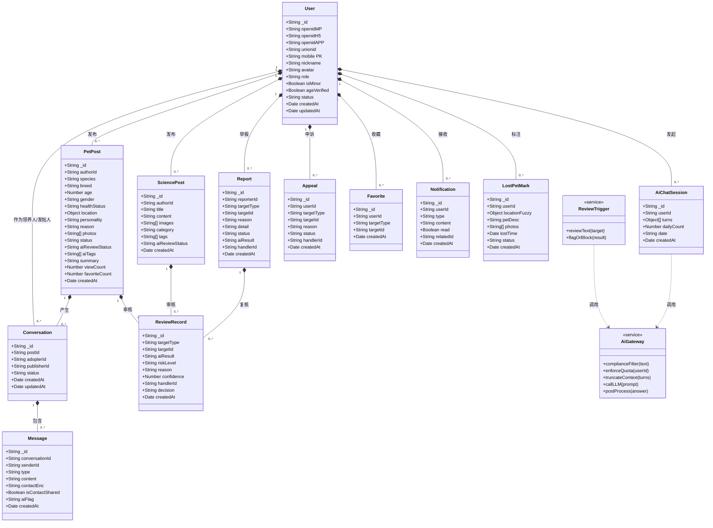
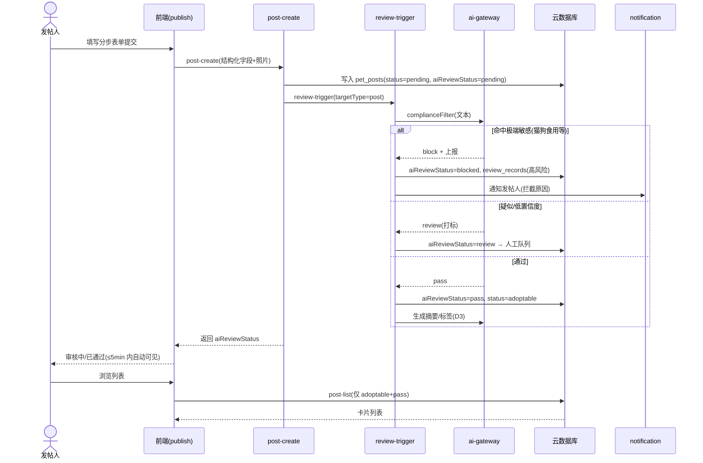
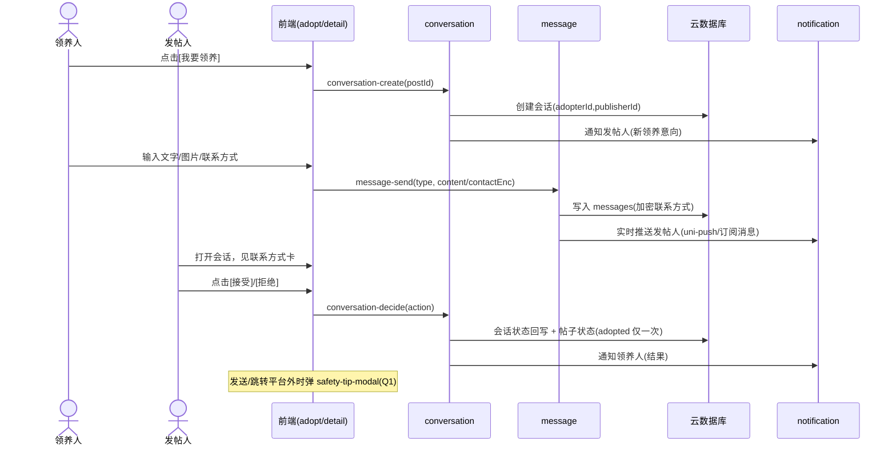
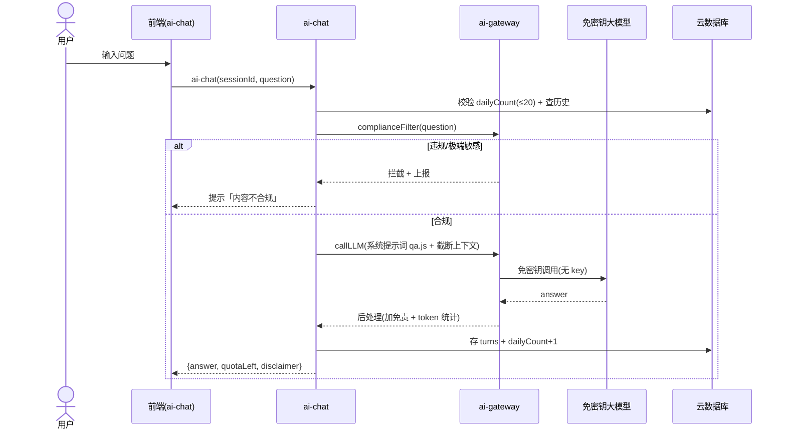
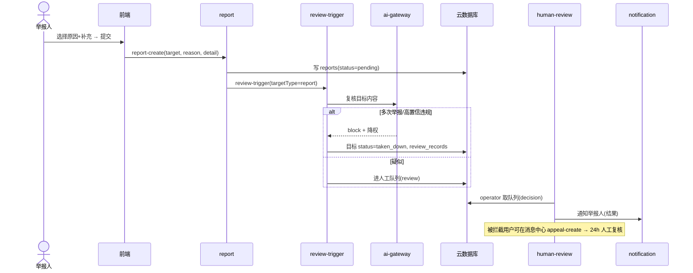

# 宠物领养与互助小程序 · 系统架构设计与任务分解（SDD）

| 项目 | 内容 |
| --- | --- |
| **版本** | v1.0（架构设计初稿） |
| **日期** | 2025-11-02 |
| **作者** | 高见远 / 架构师 |
| **文档状态** | 评审中（待 team-lead / 产品经理 / 运营确认） |
| **前置输入** | PRD 宠物领养与互助小程序 v1.0（许清楚 / 产品经理） |
| **适用范围** | V1.0（Sprint 1–3）及地图寻宠前瞻（Sprint 4） |

> 本阶段只做架构设计与任务分解，**不编写业务实现代码**。所有接口/字段/调用流为约定，供工程师落地。

---

## 1. 实现方案总览 + 框架选型

### 1.1 总体架构

采用「**uniapp 多端前端 + 云端 Serverless 后端 + 免密钥 AI 网关**」三层架构：

```
┌─────────────────────────────────────────────────────────────┐
│  客户端（uniapp 编译，同一份代码条件编译出三端）              │
│  微信小程序  /  H5(微信内/外)  /  App(iOS+Android)            │
└───────────────┬─────────────────────────────────────────────┘
                │ uni.request（统一网关，HTTPS + 签名 + 限频）
┌───────────────▼─────────────────────────────────────────────┐
│  云端 Serverless 层（云函数 / 云数据库 / 云存储）             │
│  ├─ 业务云函数：auth / post / conversation / science /        │
│  │             report / appeal / notification / lostpet       │
│  ├─ 审核云函数：review-trigger（AI 初审）/ human-review       │
│  └─ 网关云函数：ai-gateway（封装免密钥大模型，详见 1.4）      │
├───────────────┬─────────────────────────────────────────────┤
│  数据层        │  云数据库（集合式，带 RLS 权限） + 云存储     │
└───────────────┴─────────────────────────────────────────────┘
                │ 免密钥调用（无 API Key，由平台托管端点）
        ┌───────▼────────┐
        │ 免密钥大模型    │  ← 仅经 ai-gateway 访问，前端永不持有密钥
        └────────────────┘
```

### 1.2 前端框架与选型

| 维度 | 选型 | 理由 |
| --- | --- | --- |
| 跨端框架 | **uniapp（Vue3 + Vite）** | 唯一满足「一份代码编译 微信小程序 + H5 + App」的成熟方案；条件编译 `// #ifdef MP-WEIXIN / H5 / APP` 处理三端差异 |
| 状态管理 | **Pinia** | Vue3 官方推荐，模块化管理 user / post / conversation / ai 状态 |
| UI 组件 | **uView Plus + uni-ui** | 覆盖表单、卡片、弹窗、TabBar；uView Plus 对 Vue3/uniapp 支持好，减少自研组件 |
| 路由 | **uniapp pages.json 原生路由** | 内置，三端一致 |
| 网络层 | **自封装 request.js**（基于 uni.request） | 统一鉴权头、签名、限频、错误码归一、loading |
| 地图 | **高德地图 SDK（统一适配层 map-sdk）** | 三端能力对齐，街道级模糊；封装适配屏蔽 wx / jsapi / 原生差异（见 6、7） |

> **条件编译三端差异点**：登录（1.3）、地图（7.1）、推送（7.3）、分享。其余业务逻辑完全复用。

### 1.3 后端 / 云服务选型对比与最终建议

| 对比项 | 方案 A：uniCloud | 方案 B：WorkBuddy cloud-service |
| --- | --- | --- |
| 云数据库 | ✅ MongoDB 式集合，原生 uniapp | ✅ 云数据库 + RLS 行级权限 |
| 云函数 | ✅ 原生，与 uniapp 同一控制台 | ✅ 云函数（HTTP 触发器），uni.request 调用 |
| 用户认证（三端） | ✅ **uni-id 成熟**，微信小程序/H5/App + 手机号绑定天然支持 | ✅ 微信登录 + 手机号验证码登录 |
| 云存储（图片） | ✅ 原生 | ✅ 文件存储 |
| **免密钥大模型** | ❌ 需自行对接第三方（有密钥/成本） | ✅ **原生提供，零 API 费用** |
| 零运维 | ✅ | ✅ |
| 隐私合规（联系人对会话双方可见） | 需自建权限逻辑 | ✅ RLS 行级权限天然契合 |

**最终建议（主选）：方案 B —— WorkBuddy cloud-service 为统一后端底座。**
- 硬性约束「免密钥大模型（零成本）」是决定性因素，仅方案 B 原生满足；
- 云数据库 + RLS 权限 + 文件存储 + 微信/手机号认证一体化，**单厂商、零运维**；
- RLS 行级权限天然契合「联系方式仅会话双方可见」的隐私要求（见 3、7.5）；
- uniapp 前端通过 `uni.request` 调用其云函数 API，无额外适配成本。

**备选（若团队更看重 uni-id 登录成熟度）：混合方案** —— uniCloud 主体（DB/函数/uni-id 登录/存储）+ 独立云函数封装 WorkBuddy 免密钥大模型网关。该方案以 uniCloud 云函数 `ai-gateway` 内部调用免密钥 LLM 端点，同样满足零密钥零成本，但引入两厂商，运维与数据一致性成本更高，**非首选**。

> 本文后续设计以**主选方案 B（WorkBuddy cloud-service）** 为准；若落地时改选混合方案，仅需将「云函数运行环境」从 WorkBuddy serverless 替换为 uniCloud 云函数，接口契约不变。

### 1.4 免密钥大模型调用方式与网关设计（关键）

**原则**：前端/审核服务**永不直接**调用大模型；所有 LLM 访问统一经 `ai-gateway` 云函数（网关），密钥由平台托管，开发者不可见。

**ai-gateway 职责（单一职责，所有 AI 能力的出入口）**：
1. **合规前置过滤**：接收文本 → 先过本地敏感词库 + 极端敏感规则（猫狗食用、色情暴力违禁品、未成年相关）→ 命中即拦截并上报（高风险），不进入模型；
2. **限频**：单用户日调用上限 **20 次**（按 `userId + 日期` 计数，DB/缓存）；超限返回 `QUOTA_EXCEEDED`；
3. **上下文管理**：单会话 ≤ N 轮（建议 10 轮）且总 token ≤ 上限（建议 4k），超出截断最旧轮次；
4. **模型调用**：调用平台免密钥大模型端点（无 key），传入集中管理的提示词（见 8.4）；
5. **后处理**：附加「AI 生成，仅供参考，必要时就医」免责；记录 token 消耗用于监控告警；
6. **可观测**：每日 token 总量统计 + 阈值告警（护栏指标）。

**调用关系**：`前端/审核云函数 → ai-gateway（合规+限频+上下文）→ 免密钥大模型`。审核（D1/D2）、科普问答（B3）、摘要标签（D3）全部复用此网关。

---

## 2. 工程目录结构（uniapp 多端）

```
pet-adoption/
├── src/
│   ├── main.js                      # 入口：挂载 Pinia、全局配置
│   ├── App.vue                      # 应用根，全局登录态初始化
│   ├── pages.json                   # 路由 + TabBar（uniapp 原生）
│   ├── manifest.json                # 多端配置（小程序 AppId / H5 / App）
│   ├── uni.scss                     # 全局样式变量
│   ├── env/
│   │   ├── index.js                 # 环境切换（dev/test/prod）入口
│   │   └── config.js                # 端点、地图 Key、开关（见 8.5）
│   ├── api/                         # 云函数/接口封装（统一走 request.js）
│   │   ├── auth.js                  # 登录、绑定手机号、用户信息
│   │   ├── post.js                  # 发帖/列表/详情/改状态/收藏
│   │   ├── conversation.js          # 会话创建/消息/接受拒绝
│   │   ├── science.js               # 科普帖 CRUD
│   │   ├── ai.js                    # AI 问答（调 ai-gateway）
│   │   ├── review.js                # 审核结果查询、人工复核（运营端）
│   │   ├── report.js                # 举报、申诉
│   │   ├── notification.js          # 消息中心
│   │   └── lostpet.js               # 寻宠标记（P2）
│   ├── store/                       # Pinia 状态
│   │   ├── user.js                  # 当前用户、登录态、未成年标记
│   │   ├── post.js                  # 列表/筛选/详情缓存
│   │   ├── conversation.js          # 会话与消息
│   │   └── ai.js                    # 问答会话
│   ├── components/                  # 公共组件
│   │   ├── post-card.vue            # 帖子卡片
│   │   ├── filter-bar.vue           # 筛选栏
│   │   ├── chat-bubble.vue          # 会话气泡（含领养意向卡/联系方式卡）
│   │   ├── safety-tip-modal.vue     # 平台外沟通安全提示弹窗（Q1）
│   │   └── map-picker.vue           # 地图选点（模糊到街道级，P2）
│   ├── pages/
│   │   ├── home/                    # Tab1 首页（推荐流 + 搜索入口）
│   │   ├── adopt/                   # Tab2 领养（筛选 + 列表 + 详情）
│   │   │   ├── list.vue
│   │   │   └── detail.vue           # 含 [收藏][我要领养]
│   │   ├── publish/                 # 发布分步表单（A1）
│   │   │   └── index.vue
│   │   ├── science/                 # Tab3 科普（信息流 + 发帖 + AI 问答）
│   │   │   ├── list.vue
│   │   │   ├── post.vue
│   │   │   └── ai-chat.vue
│   │   ├── message/                 # Tab4 消息（会话列表 + 系统通知）
│   │   │   ├── conversation-list.vue
│   │   │   ├── chat.vue
│   │   │   └── notification.vue
│   │   ├── mine/                    # Tab5 我的（资料/发布/收藏/设置）
│   │   │   └── index.vue
│   │   └── lostpet/                 # P2 寻宠（Sprint 4）
│   ├── utils/
│   │   ├── request.js               # 统一请求：鉴权头 + 签名 + 限频 + 错误归一
│   │   ├── auth.js                  # 微信三端登录适配（条件编译）
│   │   ├── upload.js                # 图片上传云存储
│   │   ├── crypto.js                # 联系方式加密（端到端字段加密）
│   │   ├── minor.js                 # 未成年校验工具
│   │   └── format.js                # 时间/地点格式化
│   ├── constants/
│   │   ├── errorCode.js             # 全局错误码（见 8.2）
│   │   ├── enum.js                  # 状态枚举（帖状态/审核/举报原因…）
│   │   └── config.js                # 业务常量（日调用上限 20 等）
│   ├── prompts/                     # AI 提示词集中管理（见 8.4）
│   │   ├── review.js                # 审核提示词 + 风险分级
│   │   ├── qa.js                    # 科普问答系统提示词
│   │   └── summary.js               # 摘要/标签提示词
│   └── styles/
│       └── global.scss
├── cloudfunctions/                  # 云端函数（WorkBuddy serverless；若混合方案则为 uniCloud 云函数）
│   ├── common/
│   │   ├── ai-gateway/              # ★ 免密钥大模型网关（合规+限频+上下文+摘要）
│   │   ├── auth-middleware/         # 云函数统一鉴权（见 8.3）
│   │   └── sensitive-words/         # 敏感词库 + 极端敏感规则（猫狗食用等）
│   ├── auth-login/                  # 微信三端登录 + 手机号绑定 + 账号合并
│   ├── post-create/                 # 发帖（触发审核）
│   ├── post-list/                   # 列表/详情/筛选/改状态/收藏
│   ├── conversation/                # 会话 + 消息 + 接受/拒绝（含安全提示开关）
│   ├── ai-chat/                     # AI 科普问答（调 ai-gateway）
│   ├── review-trigger/              # AI 初审（文本；调用 ai-gateway）
│   ├── human-review/                # 人工复核队列（运营端，SLA 24h）
│   ├── report/                      # 举报创建 + 复核闭环
│   ├── appeal/                      # 申诉通道
│   ├── notification/                # 消息/订阅消息/推送
│   ├── science-post/                # 科普帖 CRUD（触发审核）
│   └── lostpet/                     # 寻宠标记 + 附近查询（P2）
├── database/
│   └── schema/                      # 集合 schema / 索引定义（见 3）
└── docs/
    ├── PRD宠物领养与互助小程序.md
    └── 架构设计宠物领养与互助小程序.md（本文）
```

---

## 3. 数据模型与接口

### 3.1 实体关系图（Mermaid classDiagram）

> 关系标记：`* -- ` 一对多；`..>` 依赖/调用；`<<service>>` 为云端服务模块。



### 3.2 关键集合 / 表字段与索引

**users（用户，手机号为主键 userKey）**
| 字段 | 类型 | 说明 | 索引 |
| --- | --- | --- | --- |
| `_id` | String | 用户唯一 ID | PK |
| `mobile` | String | 手机号（账号主键，三端合并依据） | 唯一索引 |
| `openidMP/openidH5/openidAPP` | String | 各端 openid | 分别索引 |
| `unionid` | String | 微信开放平台 unionid（跨端同主体识别） | 索引 |
| `nickname/avatar` | String | 昵称头像 | — |
| `role` | String | user/admin/operator | — |
| `isMinor` | Boolean | 未成年标记 | — |
| `ageVerified` | Boolean | 年龄/实名校验通过 | — |
| `status` | String | active/blocked | — |

**pet_posts（领养帖）**
| 字段 | 类型 | 说明 | 索引 |
| --- | --- | --- | --- |
| `authorId` | String | 发帖人 | 索引 |
| `species/breed` | String | 品种 | 索引(species) |
| `age/gender/healthStatus` | 混合 | 年龄/性别/健康 | 索引 |
| `location` | Object | `{city, district, geo?}` 模糊到区/街道 | 索引(city) |
| `photos` | String[] | ≤6 张 | — |
| `status` | String | pending/adoptable/reserved/adopted/taken_down | 索引 |
| `aiReviewStatus` | String | pending/pass/blocked/review | 索引 |
| `aiTags/summary` | 混合 | AI 标签/摘要（D3） | 索引(tags) |
| `viewCount/favoriteCount` | Number | 统计 | — |

**conversations / messages（会话/消息）**
- `conversations`: `postId, adopterId, publisherId, status(active/accepted/rejected/closed)`；索引 `(postId)`, `(adopterId,publisherId)`, `(status,updatedAt)`
- `messages`: `conversationId, senderId, type(text/image/contact), content, contactEnc(加密), isContactShared, aiFlag`；索引 `(conversationId,createdAt)`。**`contactEnc` 加密存储，无公开索引，仅会话双方经云函数读取（RLS/权限层控制）。**

**ai_chat_sessions（AI 问答会话）**：`userId, turns[], dailyCount, date`；索引 `(userId,date)` 用于限频。

**review_records（审核记录）**：`targetType(post/science/qa/message), targetId, aiResult(pass/block/review), riskLevel, reason, confidence, handlerId, decision`；索引 `(targetType,targetId)`, `(aiResult,createdAt)`。可审计（US-08 AC2）。

**reports / appeals（举报/申诉）**：`reporterId, targetType, targetId, reason(广告/违规/重复/敏感/其他), detail, status, aiResult, handlerId`；索引 `(targetType,targetId,status)`。多次举报自动降权（US-07 AC3）。

**lost_pet_marks（寻宠标记，P2）**：`userId, locationFuzzy{street,city,geoTruncated}, petDesc, photos, lostTime, status`；**位置模糊到街道级**，geo 精度截断保护隐私（Q3）。

### 3.3 云端函数 / 接口约定（示例契约）

统一请求：`POST /{functionName}`，Header 带 `Authorization: Bearer {token}` + `X-Sign`（签名防刷）。统一响应：`{ code, data, message }`（见 8.2）。

| 函数 | 入参（摘要） | 出参（摘要） | 鉴权 |
| --- | --- | --- | --- |
| `auth-login` | `{ platform: MP/H5/APP, code, iv, encryptedData }` | `{ token, user, needBindMobile }` | 公开 |
| `auth-bindMobile` | `{ mobile, smsCode }` | `{ user }` | token |
| `post-create` | `{ species, age, gender, healthStatus, location, photos, ... }` | `{ postId, aiReviewStatus }` | token + 非未成年 |
| `post-list` | `{ filter, keyword, page }` | `{ list, total }`（仅 status=adoptable 且审核 pass） | 公开/游客 |
| `post-detail` | `{ postId }` | `{ post }`（联系方式不返回） | 公开 |
| `conversation-create` | `{ postId }` | `{ conversationId }` | token |
| `message-send` | `{ conversationId, type, content/contactEnc }` | `{ messageId }` | token + 会话双方 |
| `conversation-decide` | `{ conversationId, action: accept/reject }` | `{ status }` | token + 发帖人 |
| `ai-chat` | `{ sessionId, question }` | `{ answer, quotaLeft, disclaimer }` | token + 限频 |
| `review-trigger` | `{ targetType, targetId, text, images? }` | `{ aiResult, riskLevel, reason }` | 内部 |
| `human-review` | `{ recordId, decision }` | `{ ok }` | operator |
| `report-create` | `{ targetType, targetId, reason, detail }` | `{ reportId }` | token |
| `appeal-create` | `{ targetType, targetId, reason }` | `{ appealId }` | token |
| `lostpet-create` | `{ locationFuzzy, petDesc, photos, lostTime }` | `{ markId }` | token（P2） |
| `lostpet-nearby` | `{ geo, range }` | `{ marks[] }` | 公开（P2） |

> **鉴权**：所有业务函数经 `auth-middleware` 校验 token 并注入 `userId`；联系人类接口额外校验「会话双方」身份（见 8.3）。

---

## 4. 程序调用流程（Mermaid 时序图）

> 完整时序图另存 `docs/sequence-diagram.mermaid`。

### 4.1 发布 → AI 审核 → 展示（A1/D1/US-01/08）



### 4.2 我要领养 → 会话 → 交换联系方式 → 接受/拒绝（A4/A5/US-03/04）



### 4.3 AI 科普问答链路（B3/US-10/US-12）



### 4.4 举报 → AI + 人工复核（A8/E6/US-07）



---

## 5. 任务列表（有序 · 含依赖 · 映射 Sprint）

> 原则：本列表为工程落地任务（细粒度，直接映射 PRD 用户故事与 Sprint）。实现跟踪时可向上归并为 5 个 Epic：① 基础设施 ② 账号与登录 ③ 领养主链路 ④ AI 与安全合规 ⑤ 地图(P2)。

| 任务ID | 任务名称 | 对应 PRD | 优先级 | 依赖 | Sprint |
| --- | --- | --- | --- | --- | --- |
| **T01** | 项目脚手架与多端基建：uniapp 工程、manifest 多端配置、Pinia、request 网关、env/config、错误码/枚举常量、styles | 基础 | P0 | — | S0/S1 |
| **T02** | 账号与登录体系：微信三端登录适配、`auth-login`/`bindMobile`、手机号合并账号、未成年校验、个人主页(E3) | E1/E2/E3/E5(部分) | P0 | T01 | S1 |
| **T03** | 领养帖发布与列表/筛选/详情：分步表单、`post-create`/`post-list`/`post-detail`、筛选栏、图片上传 | A1/A2/A3 | P0 | T01,T02 | S1 |
| **T04** | 我要领养 + 内置会话 + 联系方式交换：`conversation`/`message`、会话页、领养意向卡、联系方式加密卡、`safety-tip-modal`(Q1) | A4/A5/US-03/04 | P0 | T01,T02,T03 | S1 |
| **T05** | 消息通知中心：消息聚合、未读红点、`notification`、uni-push/订阅消息推送 | E4/US-06 | P0 | T01,T04 | S1/S2 |
| **T06** | AI 管理员审核引擎：`review-trigger`（文本初审）、风险打标/拦截、人工队列 `human-review`（SLA 24h）、申诉 `appeal` | D1/D2/US-08/US-07 | P0 | T01 | S2 |
| **T07** | 免密钥 AI 网关 `ai-gateway`：合规前置、日限频 20、上下文截断、摘要/标签(D3)、token 监控；`ai-chat` 问答接入 | B3/US-10/US-12/D3 | P0/P1 | T01 | S2 |
| **T08** | 全局搜索与举报闭环：`post-list` 关键词/全局搜索(E5)、`report-create` 复核闭环、多次举报降权 | E5/E6/A8/US-07 | P0 | T03,T06 | S2 |
| **T09** | 科普模块：科普信息流 `science-post` CRUD、分类/搜索、发布前 AI 合规(B1/B2/US-09) | B1/B2/US-09 | P1 | T01,T07 | S2 |
| **T10** | 收藏与状态管理打磨：`favorite` 收藏/取消、帖子状态机(预定/领养仅一次)、编辑/上下架(A6/A7/US-11) | A6/A7/US-11 | P1 | T03 | S2/S3 |
| **T11** | V1.0 验收与发布：全量 US 验收、性能/安全/合规测试、运营手册(审核阈值/申诉)、灰度发布 | 全量 | P0 | T02–T10 | S3 |
| **T12** | 地图寻宠(P2)：`map-sdk` 三端适配、丢宠标注(街道级模糊)、附近聚合查询、找到告知、AI 寻宠提醒(I4) | C1/C2/C3/I4/US-13/14/15 | P2 | T01 | S4 |

**依赖关系简述**：T01 为所有任务基座；T02/T03/T04 依赖 T01 与账号；T05 依赖会话 T04；T06/T07/T08 为横切安全/AI 能力，优先于上线前接入 T03/T04/T09；T11 为收口；T12 独立且最晚。

---

## 6. 依赖包 / 服务清单

### 6.1 前端依赖（uniapp / Vue3）
- `vue@^3` + `vite` + `@dcloudio/uni-app`（uniapp 编译基座）
- `pinia`（状态管理）
- `uview-plus`（UI 组件库）+ `uni-ui`（官方组件）
- `dayjs`（时间格式化）
- 地图 SDK：**高德地图 JS API / 微信小程序 SDK / App 原生 SDK**（统一 `map-sdk` 适配层）

### 6.2 后端 / 云服务
- **WorkBuddy cloud-service**（主选）：云数据库（含 RLS）、文件存储、用户认证（微信登录 + 手机号验证码）、**免密钥大模型**（零成本）
- 备选混合方案才需：`uniCloud`（DB/云函数/uni-id/云存储）

### 6.3 第三方服务
- **微信开放平台 / 微信公众平台**：小程序登录、H5 公众号网页授权、App 开放平台授权、unionid
- **短信验证码服务**：手机号绑定（微信 H5/App 兜底登录，或独立验证）
- **推送**：`uni-push`（覆盖小程序订阅消息/H5 站内/App 推送）统一推送
- **地图**：高德地图（Key 三端分别申请）
- **内容安全（图片审核）**：见 9 待明确 —— 免密钥 LLM 大概率不支持图片识别，图片违规审核需搭配内容安全 API（微信 `imgSecCheck` 或云厂商内容安全）

---

## 7. 跨端兼容与关键技术风险

### 7.1 登录三端差异（Q4）
| 端 | 方案 | 注意 |
| --- | --- | --- |
| 微信小程序 | `wx.login` → code → 换 openid/unionid | 原生最顺 |
| H5 | 微信网页授权（`snsapi_userinfo`，需**公众号资质**） | 微信外打开无法授权，需手机号兜底 |
| App | 微信开放平台授权（需**企业主体 + 费用 + Universal Link**） | 配置成本高 |
**统一策略**：三端均最终绑定**手机号**为主键；同一 `mobile` 或 `unionid` 合并为同一 user（T02）。风险：H5 公众号资质、App 企业主体与费用是否具备（见 9）。

### 7.2 地图三端差异（Q3）
小程序用微信/高德 wx SDK，H5 用 JS API，App 用原生 SDK；通过 `map-sdk` 适配层屏蔽差异；位置**统一模糊到街道级**（geo 精度截断），三端一致。

### 7.3 会话实时性
- **推荐**：客户端**轻量轮询（3–5s）+ uni-push 推送**通知，避免长连接运维复杂度；满足「端到端 ≤2s」在非强实时场景下可接受。
- **增强（可选）**：若需真实时，采用 WebSocket（uniCloud/aliyun 等），但增加复杂度，建议 V1.0 先用轮询+推送。

### 7.4 AI 成本控制
- 仅经 `ai-gateway` 调免密钥模型（零 API 费）；
- 单用户日 20 次限频 + 上下文截断（≤10 轮/≤4k token）；
- 审核用轻量模型/规则优先（文本敏感词本地过滤，命中即拦截不入模型）；
- 每日 token 总量监控 + 阈值告警。

### 7.5 隐私与合规
- 联系方式：`contactEnc` **加密存储**，无公开索引；仅会话双方经云函数（RLS/权限层）读取（Q1/Q5）；
- 地理位置：寻宠模糊到街道级（Q3）；
- 未成年人：注册/发布/领养前 `isMinor`/`ageVerified` 校验，禁止未成年发布领养帖与作为领养人（Q5）；
- 极端敏感（猫狗食用等）：AI 拦截 + 上报（Q5）；
- 明示隐私政策与授权范围（合规基线）。

---

## 8. 共享知识（跨文件约定）

### 8.1 命名规范
- 云函数：`kebab-case`（如 `post-create`）；前端文件：`kebab-case`；类/Store：`PascalCase`；常量：`UPPER_SNAKE`。
- 集合名：`snake_case` 复数（`pet_posts`）；字段：`camelCase`。
- 接口响应统一 `{ code, data, message }`。

### 8.2 错误码（全局，constants/errorCode.js）
| code | 含义 |
| --- | --- |
| 0 | 成功 |
| 1001 | 未登录/ token 失效 |
| 1002 | 无权限（非会话双方/未成年受限） |
| 2001 | 参数校验失败 |
| 3001 | AI 配额超限（QUOTA_EXCEEDED，日 20 次） |
| 3002 | 内容违规被拦截 |
| 4001 | 资源不存在 |
| 5000 | 服务器/云函数内部错误 |
| 6001 | 风控/限频（签名/刷接口） |

### 8.3 云函数鉴权（auth-middleware）
- 业务函数统一校验 `Authorization` Bearer token → 解析 `userId` 注入 context；
- 联系人类接口二次校验「`userId` ∈ {adopterId, publisherId}」；
- 运营接口校验 `role=operator/admin`；
- 所有写接口加签名校验 + 限频（防刷）。

### 8.4 AI 提示词集中管理（prompts/）
- `review.js`：审核系统提示词 + 风险分级（pass/block/review）+ 极端敏感清单（猫狗食用等强制 block+上报）；
- `qa.js`：科普问答系统提示词（角色=养宠科普助手，禁止医疗确诊，末尾免责）；
- `summary.js`：摘要/标签生成提示词（一句话摘要 + ≤5 标签）；
- **集中维护**，迭代只需改 prompts，不散落业务代码。

### 8.5 环境 / 配置管理（env/）
- `dev / test / prod` 三套；`config.js` 存放端点、地图 Key、功能开关（`ENABLE_MAP`、`DAILY_AI_QUOTA=20`、`MINOR_RESTRICT=true`）；
- 密钥（大模型端点、地图 Key）仅服务端/环境变量，前端不落地。

---

## 9. 待明确事项

1. **地图厂商最终选定**：建议高德（三端覆盖好），需确认 Key 申请主体与配额。
2. **微信 H5 授权资质**：是否具备**微信公众号（服务号）**资质？否则 H5 无法微信授权，需纯手机号登录兜底。
3. **App 微信开放平台**：是否具备企业主体 + 预算（开放平台费用、Universal Link）？影响 App 端登录与分享。
4. **未成年实名校验方式**：身份证 OCR / 第三方实名（如微信实名）方案与成本待定。
5. **图片违规审核**：免密钥 LLM 大概率不支持图片识别；图片审核需搭配内容安全 API（微信 `imgSecCheck` 或云厂商），是否产生费用/选型待定 —— 影响 D1 图片审核落地方式。
6. **免密钥大模型能力边界**：具体模型名、是否支持多模态、上下文与速率限制上限，需接入前联调确认。
7. **推送方案细化**：uni-push 各端配置（小程序订阅消息模板申请、App 厂商通道）需提前准备。
8. **短信服务商**：手机号验证码服务商选型与资费。

---

> 本文为架构侧产出（方案 + 数据模型 + 接口契约 + 任务分解），不含业务实现代码，供工程师承接 Sprint 1–4。
